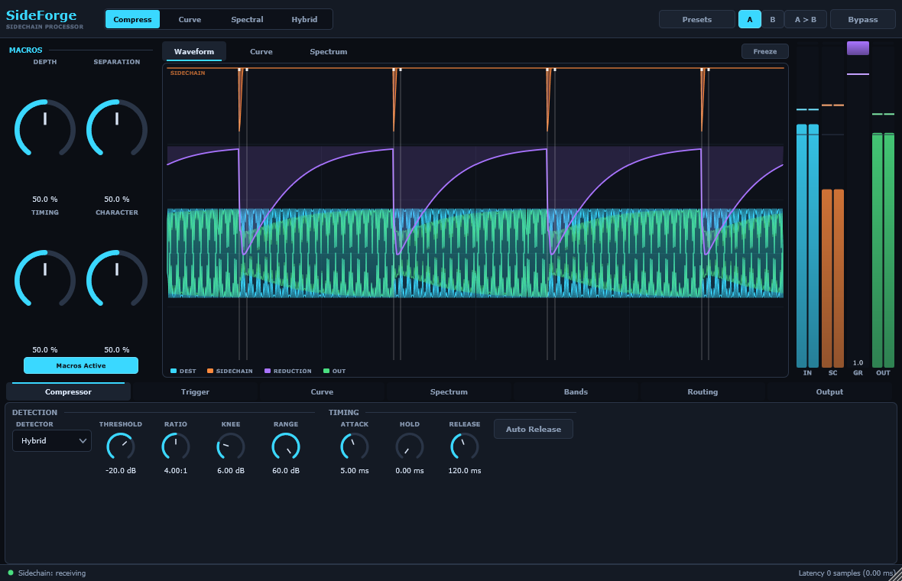
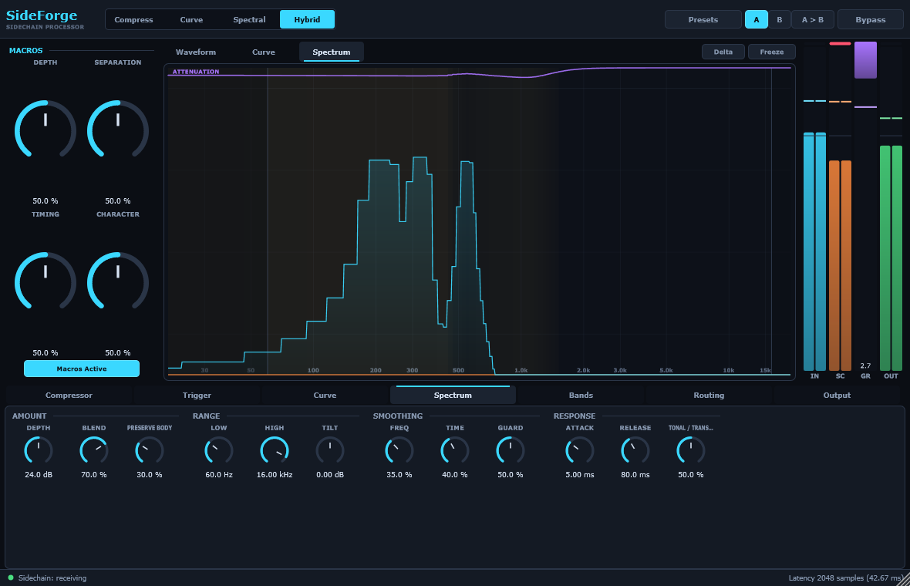
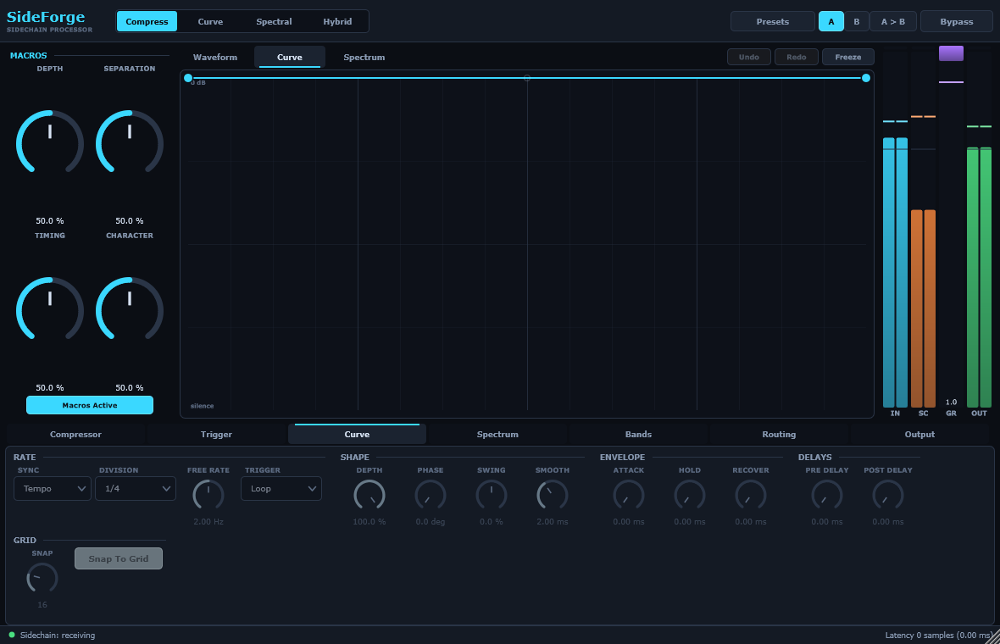
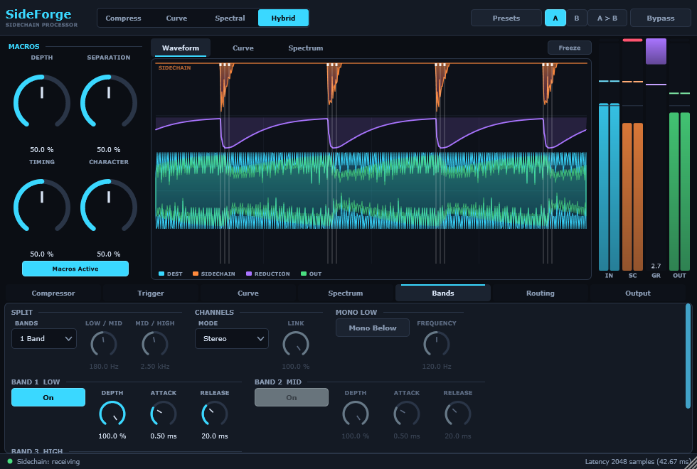
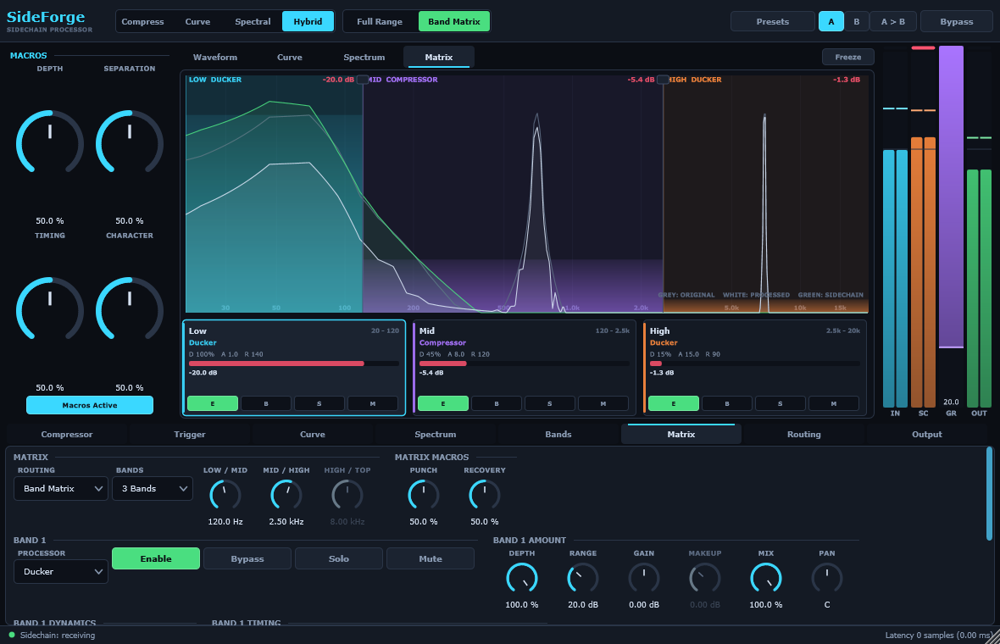

# SideForge

A Windows VST3 sidechain processor that combines four things most mixes need at
once: a classic sidechain compressor, a drawable rhythmic gain curve, multiband
and mid/side control, and spectral collision ducking.

Every engine produces a **gain signal** rather than audio. That is the idea the
whole plugin is built on: the compressor and the curve both emit a `0..1`
multiplier, so blending them is multiplication rather than a special case, the
band stage is the only thing that touches the audio, and each engine can be
tested on its own.



Compress mode: the sidechain in its own lane at the top, the gain-reduction
envelope over the destination and the output, and a tick at every trigger.

---

## Contents

- [What it does](#what-it-does)
- [Requirements](#requirements)
- [Building](#building)
- [Installing](#installing)
- [Routing the sidechain](#routing-the-sidechain)
- [Using it](#using-it)
- [The Band Matrix](#the-band-matrix)
- [Right-click, MIDI learn and automation](#right-click-midi-learn-and-automation)
- [Latency and quality modes](#latency-and-quality-modes)
- [Factory presets](#factory-presets)
- [Troubleshooting](#troubleshooting)
- [Testing](#testing)
- [Project layout](#project-layout)
- [Licence](#licence)

---

## What it does

**Two routings**, chosen with the Routing selector at the top:

| Routing | Signal path |
|---|---|
| **Full Range** | One detector and one gain signal across the whole spectrum. |
| **Band Matrix** | Up to four frequency bands, each with its own processor, timing and detector, latency-aligned and recombined. See [The Band Matrix](#the-band-matrix). |

**Four modes**, chosen with the selector next to it:

| Mode | What runs |
|---|---|
| **Compress** | Feed-forward sidechain compressor only. |
| **Curve** | The drawn rhythmic envelope only. No sidechain input needed. |
| **Spectral** | STFT collision ducking only. |
| **Hybrid** | Compressor × curve for the broadband gain, plus the spectral stage. The **Blend** control divides the work between them. |

**Compressor** — threshold, ratio (up to inf:1), soft knee, attack, hold,
release, range, peak/RMS/hybrid detection, program-dependent auto release,
detector high-pass and low-pass with audition, stereo link, lookahead and
optional auto gain.

**Curve** — a drawable envelope with movable nodes, per-segment curve / S-curve /
step shapes with adjustable tension, grid snapping, tempo divisions from 1/64
through 8 bars (straight, dotted and triplet), free-running millisecond mode,
loop / one-shot / audio-triggered / MIDI-triggered modes, swing, phase, pre- and
post-delay, attack / hold / recover rate limits and anti-click smoothing. The
phase is locked to the host's PPQ position, so starting playback in the middle of
a bar lands on the right part of the curve.

**Spectral** — an STFT that builds a **collision map** rather than inverting the
sidechain spectrum. Per bin it asks how much of the combined energy belongs to
the sidechain, gates that by whether the sidechain is meaningfully present there
at all, then raises the result to a power set by **Preserve Body** so only
decisive collisions duck. Frequency range, tilt, frequency and time smoothing,
attack / release, tonal-versus-transient sensitivity and an artifact guard that
pulls isolated notches back towards their neighbours.

**Bands and channels** — one broadband stage or three bands split by
Linkwitz-Riley 4th-order crossovers (allpass-corrected, so the bands recombine
flat to within a fraction of a dB), each with its own depth, attack, release and
bypass. Stereo, Left/Right with an adjustable link amount, or Mid/Side where the
link control decides how much of the ducking reaches the sides. Optional mono-low
stage.

**Triggers** — external sidechain, internal, MIDI note, host transport or a
manual test button, with peak, RMS, transient or K-weighted detection, its own
filter with audition, threshold, hysteresis and a minimum interval.

**Band Matrix** — 1 to 4 Linkwitz-Riley bands with draggable, glide-smoothed
crossovers; per band a choice of ducker, compressor, limiter, curve, spectral or
listen, its own depth, range, timing, gain, pan, mix and makeup, and its own
detector routing — the full sidechain, the matching sidechain band, a custom
filtered version of either, or the destination itself. Bands are padded to the
deepest one so the recombination stays phase-coherent whatever the settings.

**Monitoring** — normal, sidechain listen, delta (only what was removed),
detector audition, trigger audition, input / sidechain / output / gain-reduction
meters with peak, RMS and latching clip indicators. Monitoring replaces the
signal rather than processing it, so Mix and auto gain stand down while any
audition is engaged — you hear what you asked for, at the level it actually is.

---

## Requirements

| | |
|---|---|
| OS | Windows 10 or 11, x64 |
| Compiler | Visual Studio 2022, or the 2022 Build Tools |
| CMake | 3.22 or newer |
| JUCE | 8.0.15 |

There are no other dependencies, no network access and no copy protection.
macOS, Linux, AU, AAX and VST2 are deliberately not targeted.

---

## Building

JUCE is expected in a `JUCE/` directory next to `CMakeLists.txt` and is not
checked in:

```powershell
git clone --branch 8.0.15 --depth 1 https://github.com/juce-framework/JUCE.git JUCE
```

Then either run the build script, which does everything including the tests:

```powershell
.\Scripts\build.ps1                       # Release build + tests
.\Scripts\build.ps1 -Config Debug
.\Scripts\build.ps1 -Clean -Install       # rebuild and install the VST3
```

...or drive CMake directly:

```powershell
cmake -S . -B build -G "Visual Studio 17 2022" -A x64
cmake --build build --config Release --target SideForge_All
```

The first configure takes a few minutes because JUCE builds its `juceaide` helper.

Link-time optimisation is off by default — it adds several percent to the DSP but
around a quarter of an hour to every link, which is not a sensible trade while
iterating. Turn it on for the binaries you actually ship:

```powershell
cmake -S . -B build -G "Visual Studio 17 2022" -A x64 -DSIDEFORGE_ENABLE_LTO=ON
```

Artefacts land in:

```
build\SideForge_artefacts\Release\VST3\SideForge.vst3
build\SideForge_artefacts\Release\Standalone\SideForge.exe
```

Swap `Release` for `Debug` in both commands for a debug build.

### Tests

```powershell
cmake --build build --config Release --target SideForgeTests
.\build\SideForgeTests_artefacts\Release\SideForgeTests.exe
```

`--filter=name` runs a subset; several comma-separated patterns are allowed, for
example `--filter=spectral_,curveEngine_`.

The same runner can render the interface to PNG, which is how the screenshots
above were made and how three of the bugs listed in `PROGRESS.md` were found:

```powershell
.\build\SideForgeTests_artefacts\Release\SideForgeTests.exe --screenshots=shots
```

The VST3 bundle itself is checked separately, by a small host — see
[Troubleshooting → Validation](#troubleshooting).

---

## Installing

Copy the whole `SideForge.vst3` **folder** (not just the file inside it) to:

```
C:\Program Files\Common Files\VST3\
```

Then rescan plugins in your host. The standalone build needs no installation —
run `SideForge.exe` and pick your audio device under **Options → Audio/MIDI
Settings**.

---

## Routing the sidechain

SideForge exposes **one** external sidechain bus. That is deliberate: host
support for multiple sidechain buses is inconsistent enough that a multi-bus
design would work in some DAWs and quietly fail in others.

The footer always tells you where you stand — a red dot for *not connected*,
amber for *connected but silent*, green for *receiving*.

**Reaper** — put SideForge on the destination track, add two channels to the
track (4 total), route the trigger track to channels 3/4 of the destination, then
in the FX pin connector map track channels 3/4 to the plugin's sidechain inputs.

**Cubase / Nuendo** — activate the side-chain input in the plugin header, then
add a send from the trigger track to that side-chain destination.

**FL Studio** — route the trigger channel to the destination's mixer track with
the sidechain arrow, then choose that sidechain source in the plugin wrapper's
**Processing** settings.

**Ableton Live** — Live does not expose VST3 sidechain buses on every version. If
the sidechain input is unavailable, use **Routing → SC Source → Internal**, which
keys the plugin from the track it is sitting on, or use **Curve** mode, which is
tempo-locked and needs no sidechain at all.

**Studio One / Bitwig / Waveform** — enable the side-chain input in the plugin
header and send the trigger track to it.

No sidechain at all? **Curve** mode runs entirely from the host transport.

> **A future Sender plugin.** The trigger routing is a single switch over a
> `TrigSource` enum fed by a signal the processor chooses (`TriggerEngine`).
> A companion Sender plugin would add one more case to that switch and one shared
> lock-free buffer keyed by a bus id — the engine itself would not change. That
> is the reason the routing layer is a switch rather than a hard-wired bus read.

---

## Using it

The four **macros** at the top left are modulation over the panel parameters,
never a separate set of hidden values, so A/B and session recall stay exact:

| Macro | What it moves |
|---|---|
| **Depth** | How much gain reduction every active engine asks for. |
| **Separation** | Trades broadband ducking for spectral ducking, and makes the collision map more selective as it does. |
| **Timing** | Scales every attack and release together. |
| **Character** | Soft and transparent (wide knee, gentler ratio, slower onset) through to tight and aggressive. |

Turn **Macros Active** off to hear the panel parameters exactly as they are set.

The central display has four pages:

- **Waveform** — destination (cyan), sidechain (orange), gain reduction (violet),
  output (green) and a tick at every trigger. Click it to freeze; double-click to
  reset.
- **Curve** — the editable envelope. Drag nodes; double-click to add or remove
  one; drag the middle of a segment to bend it; right-click for segment type and
  shape presets; `Ctrl+Z` / `Ctrl+Shift+Z` to undo and redo. Hold `Shift` while
  dragging to bypass the grid.
- **Spectrum** — both spectra, the collision map in yellow through red, and the
  attenuation the spectral stage is applying. Hover for exact values. **Delta**
  overlays the spectrum of what is being removed.
- **Matrix** — the Band Matrix display: the original spectrum in grey, the
  processed one in white, the detector in green, and each band's region tinted
  in its own colour and contracting by the reduction that band is applying. Drag
  the crossover handles directly; click a band card to bring its controls up in
  the panel below. See [The Band Matrix](#the-band-matrix).



Hybrid mode. The wash marks where the kick and the chord genuinely compete, and
the violet line is what the spectral stage is taking out as a result.





The Bands panel at the minimum window size. Controls the active setup does not
use — the crossovers in one-band mode, bands 2 and 3, the channel link in Stereo
— are greyed rather than hidden, so nothing moves around under the cursor.

Controls that the active engine does not use are greyed rather than hidden, so
the layout never jumps around and you can still see what a mode ignores.

---

## The Band Matrix

Ordinary sidechaining moves the whole track. That is usually not what you want:
a kick needs room in the sub, and paying for it with a pumping hi-hat is a bad
trade. The Band Matrix splits the destination into up to four frequency bands
and gives each one **its own processor, its own timing and its own detector**, so
the low end can duck 18 dB while the top loses half a dB — or nothing at all.



Three bands in the "hard lows, light highs" configuration. The tinted regions
contract by exactly the reduction each band is applying, so the shape of the duck
is visible across frequency rather than being one number on a meter.

### Full Range or Band Matrix

The **Routing** selector next to the mode selector picks the signal path.

| | |
|---|---|
| **Full Range** | The original plugin, unchanged. One detector, one gain signal, applied across the spectrum. |
| **Band Matrix** | The destination is split at 1–3 crossovers into 1–4 bands, each processed independently, then recombined. |

Full Range is the default, and it is *byte-for-byte* the same as before the Band
Matrix existed — a test asserts that moving all 107 Band Matrix parameters leaves
the Full Range output sample-identical. Sessions saved before the feature shipped
load in Full Range and sound exactly as they did.

Switching between the two swaps the signal path, so it is not sample-continuous
the way turning a smoothed knob is. It is tested to never produce a full-scale
step, but flip it while the transport is stopped if you are printing.

### Setting the crossovers

The **Bands** control chooses 1, 2, 3 or 4 bands; 1 band means the matrix runs a
single processor over the whole spectrum, which is a useful way to get the
per-band feature set (per-band detector routing, Listen, per-band mix) without a
split.

Crossovers can be set two ways, and both write to the same automatable
parameters:

- **Drag the handles** on the display. They stay in order and keep at least a
  1.25× spacing between neighbours, so you cannot cross them over each other.
- **Type numbers** into **Low / Mid**, **Mid / High** and **High / Top** in the
  Matrix panel. Crossovers beyond the current band count are greyed.

The filters are **Linkwitz-Riley 4th-order** with allpass correction on every
band that passes a crossover, which is the part that matters: with every band set
to Off, the four bands sum back to the input with a flat magnitude response. That
is tested directly — an unprocessed matrix is transparent to within 0.5 dB at any
band count.

Crossover moves **glide** rather than jump, rate-limited to 12 octaves per second
in the log domain, so automating or dragging a crossover does not click.

### Destination band versus detector band

This is the distinction that makes the feature worth having, and the one people
get wrong first.

- The **destination band** is the slice of *your track* that this row processes.
  It is set by the crossovers and cannot be changed per band.
- The **detector source** is what that row *listens to*. It is per band, and it
  does not have to be the same slice.

| SC Source | Listens to |
|---|---|
| **External** | The whole sidechain input, unsplit. |
| **External Band** | Only the matching frequency band of the sidechain. |
| **Internal** | The whole destination signal — the plugin keys off itself. |
| **Internal Band** | Only this band of the destination. |

*External* is what you want when the trigger is a kick and every band should move
on the kick, whatever the kick's spectrum. *External Band* is what you want when
only genuine frequency collisions should matter — a hi-hat then ducks your top
band and leaves your sub alone, because there is nothing in the hi-hat's low band
to trigger it.

Each band also has its own **detector filter** (a high-pass and a low-pass on the
detector only), and its own **SC Listen** toggle, which replaces the band's audio
with exactly what that band's detector is hearing. If a band is not moving,
SC Listen is the fastest way to find out why — usually the filter is excluding
the trigger, or *External Band* is pointed at a part of the sidechain that has
nothing in it.

To hear which slice of the spectrum a band actually covers, use **S** (solo) on
its card instead: that solos the band's audio rather than its detector.

### Choosing a processor per band

| Mode | What it does |
|---|---|
| **Off** | The band passes through untouched — but still latency-aligned with the others. |
| **Ducker** | A fixed high-ratio reduction driven by the detector. Depth and Range say how far it goes; the detector says when. This is classic sidechain ducking. |
| **Compressor** | A real compressor on this band: threshold, ratio, knee, makeup. Use it when the band should respond *proportionally* to the trigger rather than simply stepping out of the way. |
| **Limiter** | A hard ceiling: ratio 40:1, a tight knee and a fast attack. For a low band that must never exceed a level while the trigger is present. |
| **Curve** | The drawable envelope from the Curve page, applied to this band only. Tempo-locked rhythmic movement in one part of the spectrum. |
| **Spectral** | Collision ducking inside this band, using the Spectrum panel's settings and this band's Depth. |
| **Listen** | Replaces this band's audio with what its detector is hearing. The same thing the band's **SC Listen** toggle does, offered as a mode because the mode is automatable and the toggle deliberately is not. |

Ducker and Compressor differ in intent more than in mechanism. A ducker is told
*how far to move*; a compressor is told *at what level to start and by how much*.
If you find yourself setting a compressor to 20:1 with a low threshold, you
wanted a ducker.

### Hard lows, light highs

The move the feature exists for:

1. **Routing → Band Matrix**, **Bands → 3**.
2. Crossovers at roughly **120 Hz** and **2.5 kHz**.
3. Band 1 (Low): **Ducker**, Depth 100%, Range 18 dB, Attack 0.4 ms, Release 140 ms.
4. Band 2 (Mid): **Off**, or a gentle Compressor at 3:1 if the mids need to settle.
5. Band 3 (High): **Ducker**, Depth 15%, Range 9 dB, Attack 18 ms, Release 60 ms.

The low end steps aside completely for the kick; the top gets a suggestion of
movement that keeps the track breathing; the mids never pump. The
**Hard Lows, Light Highs** preset is exactly this.

The slower attack on the high band is deliberate. Fast attack on the top of a mix
is audible as a click; 15–20 ms is under the beat but above the ear's threshold
for hearing the gain move on its own.

### Solo, mute, bypass, enable and delta

Each band card carries four buttons, and they mean four different things:

| | |
|---|---|
| **E** (Enable) | Off means the band's processor does nothing — the audio still passes. |
| **B** (Bypass) | The band passes its region through, still latency-aligned. |
| **S** (Solo) | Only soloed bands are heard. Solo overrides mute. |
| **M** (Mute) | The band is silent. Ignored while anything is soloed. |

Solo and mute are **monitoring** controls, so they are deliberately *not*
automatable — a soloed band saved into a session and recalled six months later as
an automation lane is a bug, not a feature. They are still saved with the session.

The global **Delta** monitor works in Band Matrix routing too, and shows the sum
of what every band removed.

### Latency

Bands do not all have the same latency: one with 10 ms of lookahead is behind one
with none, and a band in Spectral mode is behind by a whole STFT frame. Summing
them in that state would comb-filter the recombination.

So every band is **padded to the deepest band in the matrix**, and the total is
reported to the host and applied to the dry path as well. Mix, bypass and delta
stay phase-coherent at any combination of band settings, and this is tested by
feeding an impulse and measuring where it comes back out.

`matrix latency = max over bands of (band lookahead + band spectral latency)`

A matrix where every band is Off or bypassed reports zero. Adding lookahead to
one band moves the whole matrix, which is worth knowing before you reach for it
on a live input.

### CPU

Each active band is a full processing chain, so four bands cost roughly four
times one. The costs that actually matter:

- **Crossovers** are cheap — two LR4 networks (destination and sidechain) run
  regardless of how many bands are processing.
- **Spectral** mode is by far the most expensive per band, and four bands in
  Spectral mode is four STFTs. Prefer one Spectral band and Duckers elsewhere.
- **Off** bands cost only their crossover and their alignment delay.
- The **display** runs its own FFT, but only on the message thread and only while
  the Matrix page is on screen.

If a session is heavy, the first thing to try is reducing the band count: three
bands do almost everything four do.

### Troubleshooting the matrix

**A band is not moving.** Press its **Listen** button and check the detector is
hearing something. The usual causes are a detector filter that excludes the
trigger, *Sidechain (band)* on a band where the sidechain has no energy, or a
threshold that the detector never crosses.

**The recombination sounds thin or phasey.** Check that no band is muted or
disabled by accident, and that you have not left a band in Listen. A correctly
configured matrix with all bands Off is flat to within 0.5 dB.

**The whole track ducks when I only wanted the lows.** The other bands are
probably still in Ducker mode with their default depth. Set them to **Off**
explicitly — a band with a small depth is not the same as a band that is off.

**Everything got quieter when I switched to Band Matrix.** A band is muted, or
a band's Mix is below 100%. Per-band Mix blends that band's processed signal with
its own unprocessed audio, not with the whole track.

**The plugin reports more latency than I expected.** Something has lookahead or
is in Spectral mode. The whole matrix aligns to the deepest band, so one band at
20 ms costs the whole matrix 20 ms.

---

## Right-click, MIDI learn and automation

**Right-click any control** for:

- the **host's own** parameter menu, where the DAW offers one — in VST3 hosts
  this is where "add automation", the host's MIDI CC binding and "show in
  automation lane" live,
- **MIDI learn** — pick it, then move a controller. The control shows a small
  `CC n` badge once bound, and `LEARN` while it is waiting,
- **Assign MIDI CC** directly, either from the named common controllers or from
  the full 0–127 list,
- **Type value**, **Reset to default**, **Copy value** and **Paste value**.

MIDI bindings are saved with the session and keep working with the editor closed.
Controller movements are recorded on the audio thread into lock-free atomics and
applied on the message thread, so nothing calls into the host from `processBlock`.

Other interactions, on every control:

- **Double-click** — reset to default.
- **Shift-drag** — fine adjustment.
- **Double-click the value readout** — type a number directly.
- **Hover** — every control has a tooltip saying what it does and, where it is
  not obvious, what it interacts with.

**Lookahead** and **Quality** change the reported latency, so they are marked as
non-automatable. Automate them and the host would be re-negotiating latency
mid-bar; use them as setup controls instead.

---

## Latency and quality modes

In **Full Range**, `latency = lookahead + spectral`. In **Band Matrix**, it is
the deepest band's latency, and every shallower band is padded up to it so the
recombination stays phase-coherent:

```
Full Range   latency = lookahead + spectral
Band Matrix  latency = max over bands of (band lookahead + band spectral)
```

Either way it is reported to the host and applied to the dry path as well, so
mix, bypass and delta stay phase-coherent.

| Quality | STFT | Overlap | Max lookahead | Spectral latency |
|---|---|---|---|---|
| **Live** | — | — | 0 ms | none — the spectral stage is out of the path |
| **Studio** | 1024 | 4x | 5 ms | 1024 samples |
| **Spectral** | 2048 | 4x | 10 ms | 2048 samples |
| **Render** | 4096 | 8x | 20 ms | 4096 samples |

The spectral stage only reports latency while it is actually processing;
switching back to Compress or Curve gives the host its samples back immediately.

Because Live runs no STFT, **Spectral** and **Hybrid** are disabled while Live is
selected. Clicking one anyway switches the quality to Studio and selects it,
rather than doing nothing.

---

## Factory presets

### Full Range

| Preset | For |
|---|---|
| **Kick vs Bass** | Fast broadband duck keyed from the kick, with the detector listening only to the low end. |
| **Vocal vs Music** | Spectral ducking that opens space for a vocal only where the music actually collides with it. |
| **Transparent Spectral Space** | A gentle, wide collision map. Almost inaudible on its own, obvious the moment you bypass it. |
| **Four On The Floor Pump** | Tempo-locked quarter-note pump. No sidechain input required. |
| **Irregular Live Kick** | Curve re-triggered by the sidechain, for a drummer who does not play to a grid. |
| **Mid/Side Vocal Clearing** | Ducks the centre and leaves the sides open, so a lead vocal sits in front of a wide bed. |
| **Aggressive Stutter** | Sixteenth-note gate. Hard steps, minimal smoothing. |
| **Sub Only Ducking** | Three-band split with only the low band ducking, so the sub steps aside and nothing else moves. |
| **Full-Range Classic Sidechain** | No band split at all: the original full-range compressor, for when the whole track should move together. |

### Band Matrix

| Preset | For |
|---|---|
| **Kick vs Sub Bass** | Two bands. Everything under 90 Hz ducks hard for the kick; the rest of the bass is untouched. |
| **Kick vs Full Bass** | Two bands with a higher split, so the whole bass register steps aside rather than just the sub. |
| **Hard Lows, Light Highs** | The headline Band Matrix move: severe low-end space, a touch of movement up top, nothing in between that pumps. |
| **Vocal vs Music Bands** | Three bands keyed from a vocal, with the midrange taking most of the movement. |
| **Vocal Presence Pocket** | Carves a narrow presence window so a lead sits forward, leaving the low end and the air alone. |
| **Midrange Dialogue Space** | Gentle, slow midrange ducking for dialogue over a bed. Wide band, low depth, long release. |
| **Snare vs Synth Mids** | Fast, short mid-band ducking that opens a slot for a snare without touching the sub or the top. |
| **Hi-Hat vs Bright Pads** | Only the top band moves, keyed from the matching high band of the sidechain. |
| **Sub-Only Duck** | A single low band under 70 Hz ducking hard. The most surgical way to make room for a kick. |
| **Three-Band Pump** | All three bands ducking on the same trigger, with progressively lighter depth and slower attack upwards. |
| **Transparent Multiband Duck** | Low depth everywhere and slow timing. Hard to hear working, obvious the moment you bypass it. |
| **Low-Band Limiter** | A ceiling on the low band whenever the trigger hits, leaving everything above it completely alone. |
| **Mid Compression, High Duck** | Two different processors at once: the mids are compressed, the top is ducked. |
| **Wide Pads Behind Vocal** | Mid and high bands duck while the low band holds, so a pad recedes without losing its weight. |

Every preset sets the Routing itself, so loading a Band Matrix preset switches
to Band Matrix and loading a Full Range one switches back. **Full-Range Classic
Sidechain** is the deliberate way back to the original behaviour.

Your own presets save to
`%APPDATA%\SideForge\Presets\*.sideforge` — the preset menu has **Save**,
**Load** and **Open preset folder**.

---

## Troubleshooting

**Nothing happens.** Check the footer. A red dot means the sidechain is not
connected: either route one (see above), switch **SC Source** to *Internal*, or
use **Curve** mode. In Compress mode also check that the sidechain is actually
crossing the threshold — the gain-reduction meter tells you immediately.

**The sidechain is connected but the meter never moves.** The detector filter may
be excluding it. Turn on **Routing → Audition** to hear exactly what the detector
hears, and widen the high-pass / low-pass.

**Spectral mode does nothing.** It needs Studio quality or higher. Check the
mode buttons are not greyed; clicking one switches the quality for you.

**The track is out of time with the rest of the mix.** Your host is not applying
delay compensation. Either turn it on, or set Quality to **Live** and Lookahead
to 0 ms for a zero-latency configuration.

**Clicks when toggling bypass.** There should not be any — bypass crossfades over
about 15 ms. If you hear one, it is more likely the host hard-switching the
plugin; try the plugin's own Bypass control rather than the host's.

**The curve is not in time.** In Tempo sync the phase follows the host's PPQ
position, so check the host is actually sending a playhead. In Free mode the
cycle is a fixed rate and is not tempo-locked by design.

**The automation list shows thousands of parameters.** SideForge itself has
about two hundred, a little over half of them the Band Matrix's. VST3 has no raw
MIDI CC, so JUCE's wrapper publishes 128
controllers across 16 channels as parameters in order to receive them — that is
where the other ~2000 come from, and it is what lets the plugin's MIDI learn
work at all. They are grouped separately by every host that shows them.

**High CPU.** Render quality runs a 4096-point STFT at 8x overlap. Drop to Studio
for mixing. In Band Matrix routing, each active band is a full processing chain,
and a band in Spectral mode is its own STFT — so four Spectral bands is four of
them. Reduce the band count first. **Output → Visualiser → Reduced** halves the repaint rate, and
turning the visualiser off entirely leaves processing untouched.

**Validation.** The project ships its own VST3 host check, which loads the built
bundle through JUCE's VST3 hosting code — the same path a DAW takes — and
verifies scanning, instantiation, bus layouts, processing at several sample rates,
latency reporting, state round trips and the editor:

```powershell
cmake --build build --config Release --target SideForgeValidate
.\build\SideForgeValidate_artefacts\Release\SideForgeValidate.exe
```

pluginval is not installed on the machine this was built on, so it has not been
run. If you have [pluginval](https://github.com/Tracktion/pluginval):

```powershell
pluginval.exe --validate-in-process --strictness-level 8 `
  ".\build\SideForge_artefacts\Release\VST3\SideForge.vst3"
```

---

## Testing

189 deterministic tests cover the DSP, the state format and the editor. They
generate their own signals and compare with tolerances rather than by ear:

- silence in gives silence out, in every mode;
- a missing sidechain bus never crashes;
- bypass is sample-exact and click-free, and stays aligned with the reported latency;
- compressor attack, release, hold, knee continuity and range clamping;
- curve timing at five sample rates and six block sizes, mid-bar starts, tempo
  changes and transport jumps;
- trigger hysteresis, minimum interval and block-size independence;
- crossover reconstruction within 0.5 dB across the audible range, and exact
  mid/side round-tripping;
- STFT reconstruction to better than 1e-4 at every quality setting, and an
  impulse test that pins the reported latency to the actual delay;
- state round trips, malformed state, and parameter boundary values;
- mono and stereo layouts, oversized and varying block sizes, rapid automation,
  extreme and non-finite input, and a long-run stability pass;
- the editor paints at every size in its range, in every mode and on every page;
- **every parameter has a control in the editor, and every control points at a
  parameter that exists** — so the UI cannot drift away from the DSP;
- MIDI learn binds, follows, re-binds, survives a state round trip and drops
  mappings to parameters that no longer exist;
- the Band Matrix: crossover reconstruction at every band count, ordering and
  spacing under abuse, glide rate limiting, per-band latency alignment measured
  from an impulse, solo and mute semantics, every processor mode against every
  detector source, and the guarantee that Full Range output is sample-identical
  with all 107 matrix parameters moved.

### Cross-feature testing

Features are also tested **against each other**, because a plugin this
configurable fails at the seams rather than in the middle. An exhaustive product
of the discrete settings is past 10^11 combinations, so the sweep is **all-pairs**:
for every pair of settings, and every combination of values that pair can take,
one run is made with those two pinned and every other parameter randomised —
5402 configurations. On top of that:

- the cubes the Band Matrix introduced are swept exhaustively — routing x engine
  x quality x band count x band mode, and every processor mode against every
  detector source at every band count;
- all 256 solo / mute / bypass / enable states across four bands;
- the same pairs again on six host layouts from 44.1 to 192 kHz, block sizes 32
  to 1024, mono and stereo, with and without a sidechain bus;
- 3000 blocks with settings moving on every single block, which is what a host
  does with a dozen automation lanes running.

Each configuration asserts what has to hold whatever is set: the output stays
finite, the level never runs away, the reported latency is plausible, and silence
in gives silence out.

Release runs all of it, in about four minutes. A Debug build is roughly thirty
times slower per sample, so it visits every pair but samples the silence flush -
the expensive half - one configuration in sixteen. Run Release before believing
the sweep is green.

The sweep has already found one real bug — Mix and auto
makeup were being applied to the monitoring paths, so auditioning the sidechain
at 50% Mix handed you half your own track at +23 dB.

---

## Project layout

```
Source/
  PluginProcessor.*        block flow only; no DSP maths lives here
  PluginEditor.*           look and feel, window size, hosts MainView
  Parameters/              IDs, APVTS layout, macro mapping, MIDI learn
  DSP/                     every engine; no GUI includes
  Model/                   curve model, versioned state, factory presets
  UI/                      everything that draws; reads snapshots only
  Utilities/               lock-free primitives, smoothing helpers
Tests/
  DSP/  State/  Rendering/
  DSP/CrossFeatureTests.cpp   the all-pairs sweep across every discrete setting
Resources/                 icon
```

`ARCHITECTURE.md` explains the signal flow and the threading rules;
`PROGRESS.md` records what is done, what was deferred and why.

---

## Licence

SideForge is built on [JUCE](https://juce.com), which is dual-licensed under the
JUCE licence and the AGPLv3. Using it under the AGPLv3 means this project is
AGPLv3 as well; using it commercially needs a JUCE licence from Raw Material
Software. No other third-party code is included.


## Required shared plug-in standard

This project follows the [Circuit Drift Labs Shared Audio Plugin Standard](docs/standards/CDL_PLUGIN_BASELINE.md). It is required for the plug-in target; standalone-only requirements apply only when a standalone target is included. The product-specific specification supplements the shared standard and records the applicable profiles, compliance status, and any exceptions.
